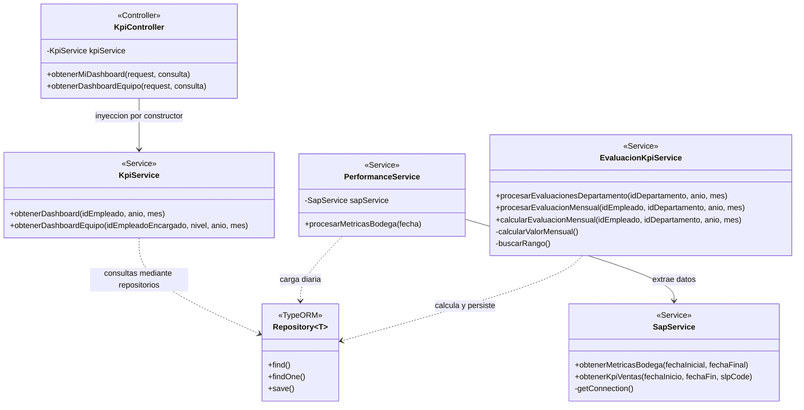
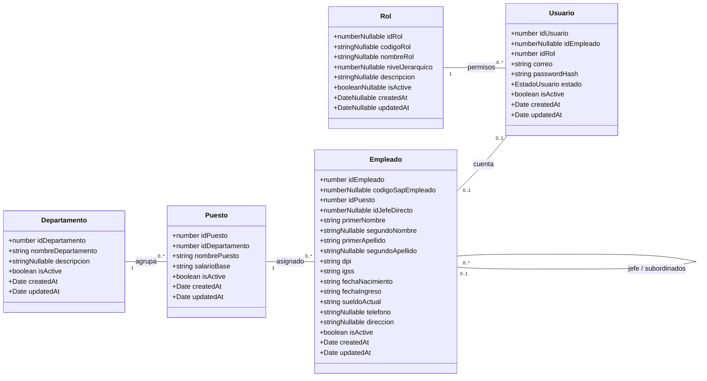
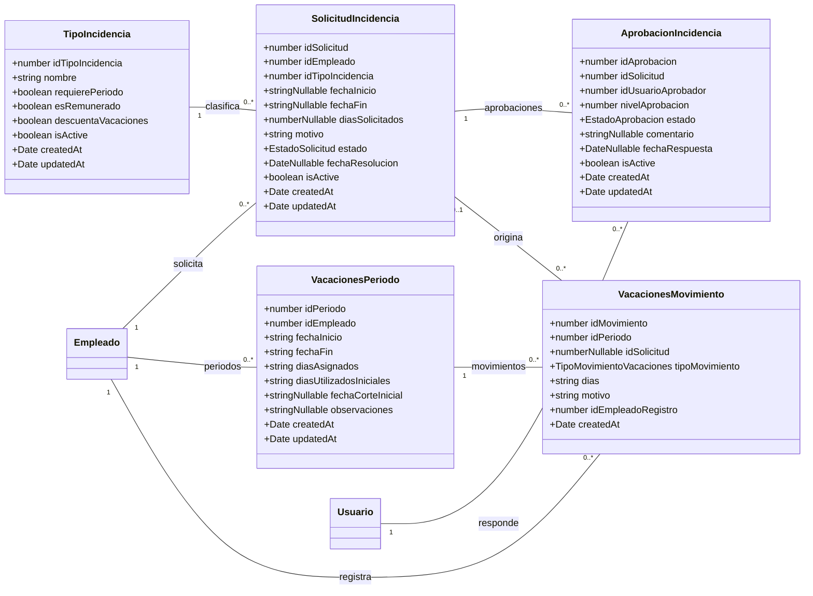
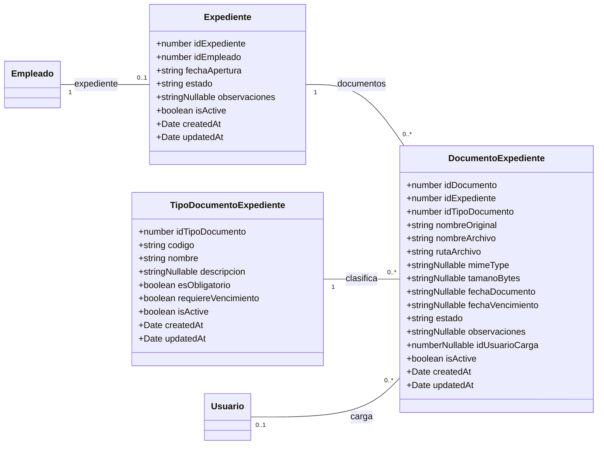
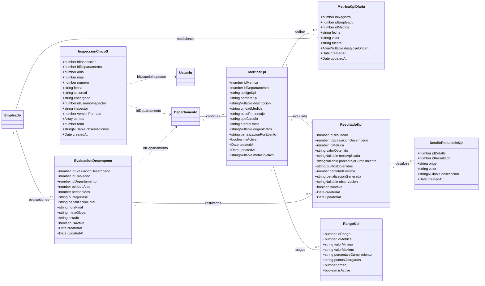
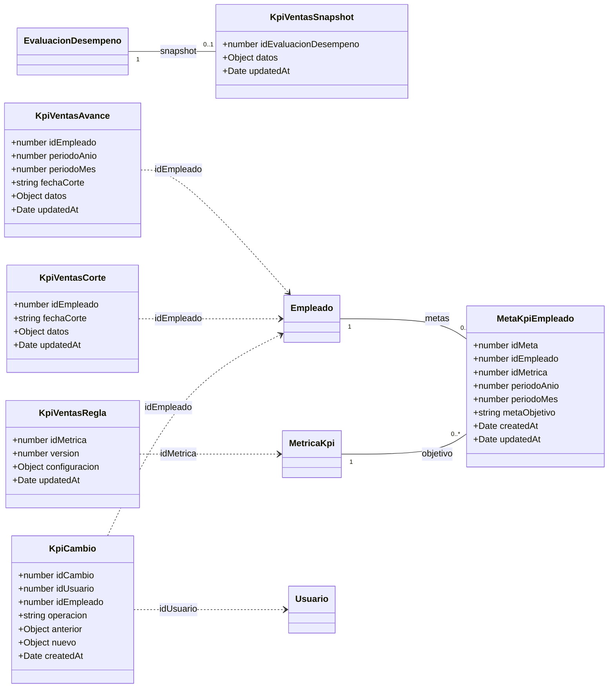
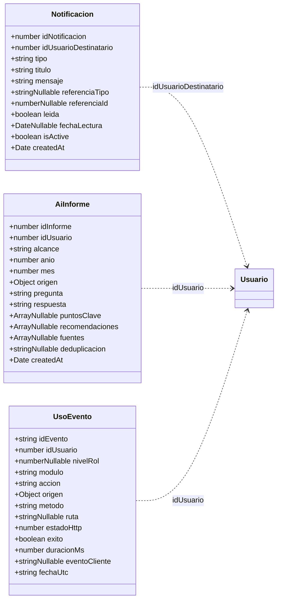

# Diagrama de clases del sistema RRHH

## Métodos y patrones: complemento de implementación

Actualización: 24 de octubre de 2026. Los seis diagramas de entidades de este documento representan el modelo persistente. Un diagrama UML de clases también puede mostrar operaciones, interfaces, clases abstractas y dependencias. En esta aplicación los métodos de negocio se encuentran principalmente en servicios; no deben añadirse métodos ficticios a las entidades.

Ejemplo real del módulo KPI, con operaciones seleccionadas. Las firmas se abrevian para facilitar la lectura; no es el inventario completo de métodos. `+` significa público y `-` privado. `Repository` es una clase genérica de TypeORM, no una clase propia del proyecto. Las flechas representan dependencias, no herencia.

`buscarRango()` permanece en el código, pero no participa en el cálculo porcentual actual de bodega. Los tres servicios KPI realizan tareas diferentes: consulta, importación y evaluación. No forman una jerarquía base/concreta.

| Patrón o mecanismo | Evidencia en el proyecto | Clasificación |
|---|---|---|
| Arquitectura por capas / Service Layer | Controladores delegan en servicios; los servicios acceden a repositorios | Organización arquitectónica; no es un patrón GoF |
| Repository | `Repository<Empleado>`, `Repository<MetricaKpi>` y otros repositorios inyectados | Patrón de acceso a datos proporcionado por TypeORM |
| Inyección de dependencias | Dependencias en constructores, `@Injectable`, proveedores registrados en módulos | Mecanismo de inversión de control de NestJS y Angular |
| Strategy en autenticación | `JwtStrategy extends PassportStrategy(Strategy)` y `JwtAuthGuard` selecciona `jwt` | Uso del mecanismo de estrategias de Passport; no hay varias estrategias propias evidenciadas |
| Observer / programación reactiva | Componentes Angular se suscriben a `valueChanges` y observables HTTP con RxJS | Uso del mecanismo de observación de RxJS |
| DTO | Clases como `ConsultarDashboardKpiDto` y `LoginDto` | Objetos de transferencia y validación de entradas |
| Proveedor con fábrica | `JwtModule.registerAsync` usa `useFactory` | Función fábrica de configuración; no prueba el patrón GoF Factory Method |

No se identificó una implementación propia de Template Method en las clases revisadas. Ese patrón requiere una operación que fije la secuencia de un algoritmo en una clase base y delegue pasos a subclases. Tener un servicio o una clase que usa `extends` no basta. Las extensiones de Passport ofrecen puntos de personalización del framework, pero no implican que los servicios de negocio implementen Template Method.

`<<Service>>` indica el rol de una clase en el diagrama; no significa que sea abstracta. Una clase abstracta se marca como tal cuando el código realmente declara esa abstracción. Los patrones se documentan mediante las clases participantes y sus relaciones, no agregando cuadros base/concretos que no existen.

Fuentes principales: `rrhh-backend/src/modules/kpi/kpi.controller.ts`, `kpi/service/kpi.service.ts`, `performance/services/performance.service.ts`, `performance/services/evaluacion-kpi.service.ts`, `integrations/sap/sap.service.ts`, `auth/strategies/jwt.strategy.ts`, `auth/auth.module.ts`; frontend: `src/app/features/kpi/pages/kpi-equipo/kpi-equipo.ts`.

Generado a partir de las entidades TypeORM del backend local, revisadas el 23 de octubre de 2026.

## Alcance y lectura

Este es el modelo de clases de dominio persistentes de la aplicación. Incluye todas las clases encontradas en archivos `*.entity.ts`; no es un inventario de todos los componentes Angular, controladores, DTO y servicios. Las entidades actuales contienen atributos y relaciones, sin métodos de negocio propios.

- Línea continua: asociación declarada mediante decoradores de TypeORM.
- Flecha discontinua: referencia lógica por identificador; no afirma que exista una clave foránea en la base instalada.
- `1`: uno; `0..1`: opcional y único; `0..*`: cero o muchos.
- Se omiten atributos de navegación duplicados porque aparecen como líneas. Las clases sin atributos en un diagrama están detalladas en otro módulo.
- Se conservan los tipos TypeScript: varios decimales de MySQL son `string`. El sufijo `Nullable` representa unión con `null` o `undefined`; `Array` y `Object` simplifican tipos complejos.
- Las multiplicidades representan el modelo y las claves declaradas; no sustituyen una inspección del esquema MySQL desplegado.

## Organización y acceso

| Clase | Tabla | Fuente |
|---|---|---|
| `Departamento` | `departamentos` | [Entidad](../../rrhh-backend/src/modules/organization/departamentos/entities/departamento.entity.ts) |
| `Puesto` | `puestos` | [Entidad](../../rrhh-backend/src/modules/organization/puestos/entities/puesto.entity.ts) |
| `Empleado` | `empleados` | [Entidad](../../rrhh-backend/src/modules/organization/empleados/entities/empleado.entity.ts) |
| `Usuario` | `usuarios` | [Entidad](../../rrhh-backend/src/modules/user/entities/user.entity.ts) |
| `Rol` | `roles` | [Entidad](../../rrhh-backend/src/modules/roles/entities/rol.entity.ts) |

## Solicitudes y vacaciones

| Clase | Tabla | Fuente |
|---|---|---|
| `TipoIncidencia` | `tipos_incidencia` | [Entidad](../../rrhh-backend/src/modules/solicitudes/entities/tipo-incidencia.entity.ts) |
| `SolicitudIncidencia` | `solicitudes_incidencia` | [Entidad](../../rrhh-backend/src/modules/solicitudes/entities/solicitud-incidencia.entity.ts) |
| `AprobacionIncidencia` | `aprobaciones_incidencia` | [Entidad](../../rrhh-backend/src/modules/solicitudes/entities/aprobacion-incidencia.entity.ts) |
| `VacacionesPeriodo` | `vacaciones_periodos` | [Entidad](../../rrhh-backend/src/modules/vacaciones/entities/vacaciones-periodo.entity.ts) |
| `VacacionesMovimiento` | `vacaciones_movimientos` | [Entidad](../../rrhh-backend/src/modules/vacaciones/entities/vacaciones-movimiento.entity.ts) |

## Expedientes

| Clase | Tabla | Fuente |
|---|---|---|
| `Expediente` | `expedientes` | [Entidad](../../rrhh-backend/src/modules/expedientes/entities/expediente.entity.ts) |
| `DocumentoExpediente` | `documentos_expediente` | [Entidad](../../rrhh-backend/src/modules/expedientes/entities/documento-expediente.entity.ts) |
| `TipoDocumentoExpediente` | `tipos_documento_expediente` | [Entidad](../../rrhh-backend/src/modules/expedientes/entities/tipo-documento-expediente.entity.ts) |

## KPI y evaluación

| Clase | Tabla | Fuente |
|---|---|---|
| `MetricaKpi` | `metricas_kpi` | [Entidad](../../rrhh-backend/src/modules/performance/entities/metrica-kpi.entity.ts) |
| `MetricaKpiDiaria` | `metricas_kpi_diarias` | [Entidad](../../rrhh-backend/src/modules/performance/entities/metrica-kpi-diaria.entity.ts) |
| `EvaluacionDesempeno` | `evaluaciones_desempeno` | [Entidad](../../rrhh-backend/src/modules/performance/entities/evaluacion-desempeno.entity.ts) |
| `ResultadoKpi` | `resultados_kpi` | [Entidad](../../rrhh-backend/src/modules/performance/entities/resultado-kpi.entity.ts) |
| `DetalleResultadoKpi` | `detalle_resultado_kpi` | [Entidad](../../rrhh-backend/src/modules/performance/entities/detalle-resultado-kpi.entity.ts) |
| `RangoKpi` | `rangos_kpi` | [Entidad](../../rrhh-backend/src/modules/performance/entities/rango-kpi.entity.ts) |
| `InspeccionCincoS` | `inspecciones_cinco_s` | [Entidad](../../rrhh-backend/src/modules/kpi/cinco-s/inspeccion-cinco-s.entity.ts) |

## Extensiones de KPI de ventas

| Clase | Tabla | Fuente |
|---|---|---|
| `MetaKpiEmpleado` | `metas_kpi_empleado` | [Entidad](../../rrhh-backend/src/modules/performance/entities/meta-kpi-empleado.entity.ts) |
| `KpiVentasRegla` | `kpi_ventas_reglas` | [Entidad](../../rrhh-backend/src/modules/performance/entities/kpi-ventas-regla.entity.ts) |
| `KpiVentasAvance` | `kpi_ventas_avance` | [Entidad](../../rrhh-backend/src/modules/performance/entities/kpi-ventas-avance.entity.ts) |
| `KpiVentasCorte` | `kpi_ventas_corte` | [Entidad](../../rrhh-backend/src/modules/performance/entities/kpi-ventas-avance.entity.ts) |
| `KpiVentasSnapshot` | `kpi_ventas_snapshot` | [Entidad](../../rrhh-backend/src/modules/performance/entities/kpi-ventas-snapshot.entity.ts) |
| `KpiCambio` | `kpi_cambios` | [Entidad](../../rrhh-backend/src/modules/performance/entities/kpi-cambio.entity.ts) |

## Notificaciones, IA y uso

| Clase | Tabla | Fuente |
|---|---|---|
| `Notificacion` | `notificaciones` | [Entidad](../../rrhh-backend/src/modules/notificaciones/entities/notificacion.entity.ts) |
| `AiInforme` | `ai_informes` | [Entidad](../../rrhh-backend/src/modules/ai/entities/ai-informe.entity.ts) |
| `UsoEvento` | `uso_eventos` | [Entidad](../../rrhh-backend/src/modules/uso/uso-evento.entity.ts) |

## Observaciones del modelo actual

- `Empleado` se relaciona consigo mismo para representar jefe directo y subordinados. Un usuario puede existir sin empleado asociado.
- Un expediente pertenece a un empleado; `id_empleado` es único en `Expediente`.
- `VacacionesMovimiento` puede no tener solicitud asociada, por ejemplo en ajustes. El empleado que registra un movimiento es distinto conceptualmente del propietario del período.
- `vw_vacaciones_saldos` es una vista de consulta mencionada en el sistema, no una clase de entidad encontrada en este inventario.
- `RangoKpi` existe en el modelo aunque el cálculo actual de bodega usa porcentajes directos.
- `KpiVentasSnapshot` declara `ManyToOne`, pero su identificador de evaluación es también clave primaria, por lo que solo puede haber un snapshot por evaluación.
- `Notificacion.referenciaTipo` y `referenciaId` forman una referencia variable; no se dibuja una asociación fija a solicitudes u otro módulo.
- Las inspecciones 5S se relacionan lógicamente con evaluaciones por departamento y período; no tienen un `idEvaluacion` directo.
